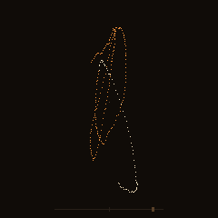
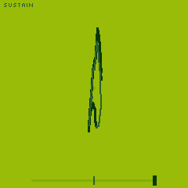

# Modular Landscape

 

**EN** · A free firmware for the **M-VAVE SMK-37 Elite** and the **M-VAVE FM-1**, by
[Bungle Society](https://www.youtube.com/@bunglesociety). A folk guitar played with a bow, recorded by the composer
Alexis Arakis for this instrument, and effects made for film music. One sound, no banks, no menus. The screen shows
the stereo image of what you play.

**FR** · Un firmware libre pour le **M-VAVE SMK-37 Elite** et le **M-VAVE FM-1**, par
[Bungle Society](https://www.youtube.com/@bunglesociety). Une guitare folk jouée à l'archet, enregistrée par le
compositeur Alexis Arakis pour cet instrument, et des effets pensés pour la musique de film. Un seul son, sans banque
ni menu. L'écran montre l'image stéréo de ce que tu joues.

## Install / Installer

In Chrome or Edge, on a computer / Dans Chrome ou Edge, sur un ordinateur :

- **SMK-37 Elite**, version 1.0: [bunglesociety.github.io/modular-landscape/smk37/](https://bunglesociety.github.io/modular-landscape/smk37/)
  (the same page puts the original firmware back / la même page remet le firmware d'origine)
- **FM-1**, version 0.4.2 beta: [bunglesociety.github.io/modular-landscape/fm1/](https://bunglesociety.github.io/modular-landscape/fm1/)
  (back to the original firmware: M-VAVE's updater / retour au firmware d'origine : l'outil de M-VAVE)

The packages are also on the [Releases](https://github.com/bunglesociety/modular-landscape/releases) page and in
`docs/firmware/`. Identity / identité : `SMK-37 Elite_894`, `FM-1_894`, the same for every release.

| File | SHA-256 |
|---|---|
| `modular-landscape-smk37-elite-1.0.fwsc` | `867bca014534a404044d685a3e3fd2cbb7d6b82164ef76406a5656db4b7a7a34` |
| `modular-landscape-fm1-0.4.2.fwsc` | `84c0f973c13df839cf834d34e4a063229bfcbb57dc9a6cbc34bf6af00301316a` |

Installing replaces the M-VAVE firmware; its presets are lost. Unofficial firmware, no warranty: you install it at your
own risk. / L'installation remplace le firmware M-VAVE ; ses presets sont perdus. Firmware non officiel, sans garantie :
tu l'installes à tes risques.

## The controls / Les commandes

**SMK-37 Elite**

| | |
|---|---|
| Pads 9–16 | SUSTAIN, BREATH, CONTRA, DRONE, WIDTH, DISTANCE, MUTE, ECHO: a touch turns the effect on or off |
| K1–K8 | the knob above each pad: how much of its effect (K1: the overall volume) |
| Faders | ATTACK, RELEASE, SPACE (reverb), LENGTH (the bow stroke) |
| Mod wheel | PURE: the bow's noise goes, the note stays |
| Pads 1–8 | sketches: touch to record, touch again to keep, a full pad loops; held 1 s: erase |

**FM-1**

| | |
|---|---|
| K1–K4 | LENGTH, ATTACK, SPACE, RELEASE |
| PRESETS | PURE |
| FX · SCL · ENV · LFO | SUSTAIN · BREATH · CONTRA · DRONE |
| EDIT · ARP · HOME | DISTANCE · MUTE · ECHO; SELECT sets how much of the last effect touched |
| SAVE | keeps the knobs, the effects' amounts and PURE for the next power-on; held 2 s: the factory ones |
| PLAY · REC · SEQ | Modular One's tape and sketchbook |
| OCT- · OCT+ | the octave; both held 1 s: the tape |

## Build / Compiler

`./build.sh` makes both packages, byte for byte the released ones. It needs what Felucca needs: the JieLi toolchain and
the AC79 SDK (see `smk37/BUILDING.md`).

- `smk37/`: the SMK-37 tree (Modular Compagnon's, built with `ARCHET=1`: `firmware/src/archet.c`, `ar_land.c`)
- `fm1/`: the FM-1 tree (Modular One's, `BOARD=land`: `firmware/src/ls_ui.c`, `ls_draw.c`)
- `site/make_site.py`: the install pages in `docs/` and the bunglesociety.com block

## Licences

The code is free software, **GPL-3.0-only** ([LICENSE](LICENSE)); the parts from others keep their licences
(`smk37/LICENSING.md`, `smk37/CREDITS.md`). **The guitar recordings are not under the GPL**: they are Alexis Arakis's,
usable in your music, not to be extracted or resold. See [SOUNDS.md](SOUNDS.md).

Based on [Felucca](https://github.com/hugelton/Felucca) by Leo Kuroshita (@kurogedelic),
[Hügelton Instruments](https://hugelton.com). Heartfelt thanks to him. M-VAVE, SMK-37 and FM-1 are trademarks of their
respective owners; Modular Landscape is not made or supported by M-VAVE or Hügelton Instruments.
